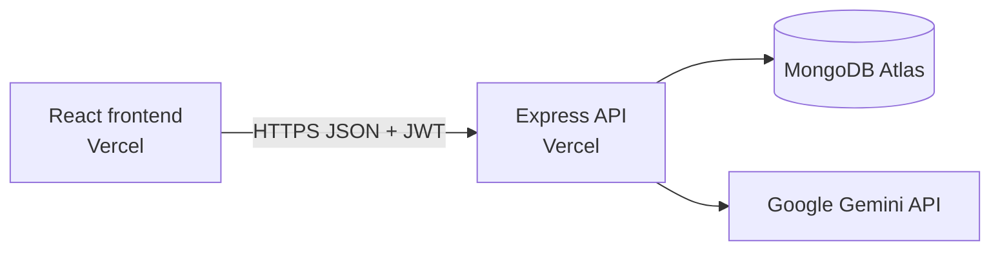

# Peer Tutoring Booking Platform API

An Express and TypeScript API for tutors, sessions, bookings, JWT authentication, and Gemini-powered tutoring-session preparation.

- Live frontend: https://itelect4-project-self.vercel.app
- Live API health: https://itelect4-backend-five.vercel.app/api/health

## Architecture

## Run locally

Requires Node.js 24, npm, a MongoDB database, and a Gemini API key.

1. Run `npm install`.
2. Copy `.env.example` to `.env`.
3. Set `MONGODB_URI`, `JWT_SECRET`, `GEMINI_API_KEY`, `PORT`, and `CORS_ORIGIN` in `.env`. Never commit the real values.
4. Run `npm run dev`; the default API URL is `http://localhost:4000`.

Use `npm test` for the isolated route tests, `npm run typecheck` for TypeScript checks, and `npm run build` for the production build.

## AI-use disclosure

ChatGPT/Codex assisted with implementation, testing, CI configuration, and documentation. The author reviewed the generated changes, ran the local verification commands, and remains responsible for the submitted work.
